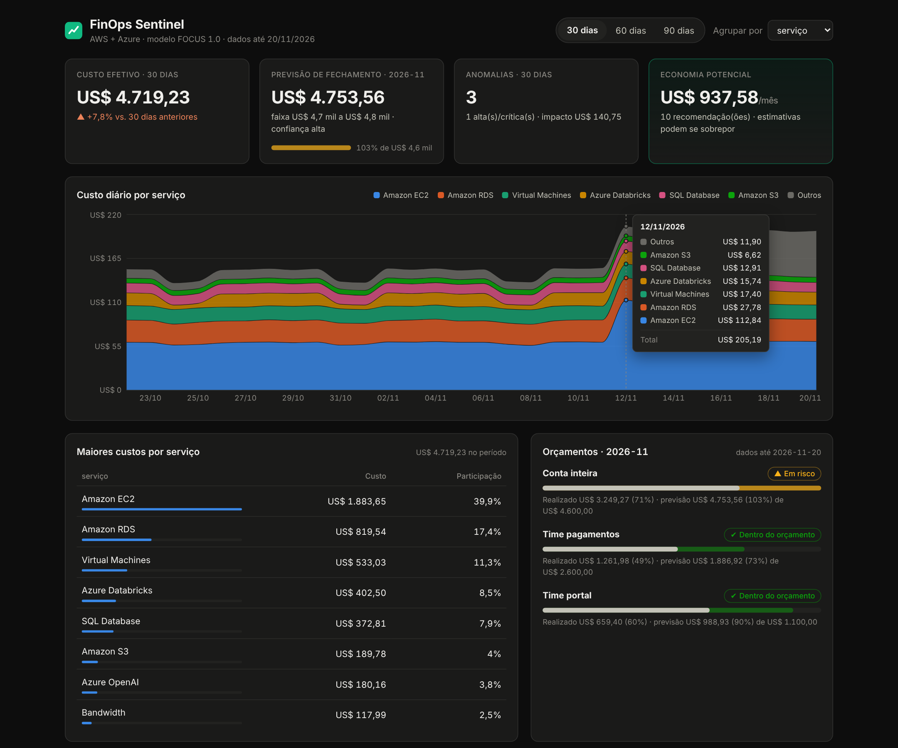
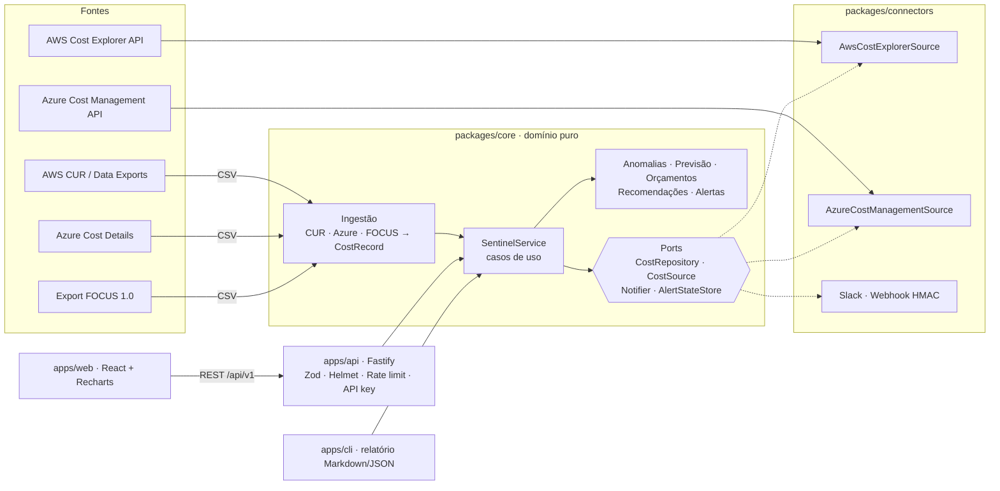
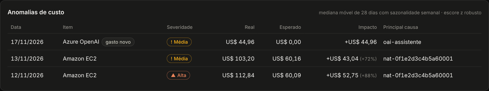
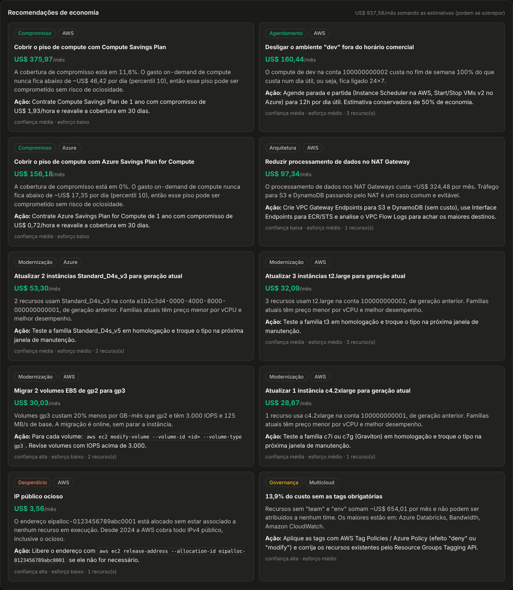

<div align="center">

# FinOps Sentinel

**Painel FinOps multicloud (AWS + Azure): unifica o billing no padrão FOCUS, detecta anomalias de custo, prevê o fechamento do mês e aponta onde economizar.**

[](https://github.com/lucassantana2301-bot/finops-sentinel/actions/workflows/ci.yml)
[](https://github.com/lucassantana2301-bot/finops-sentinel/actions/workflows/codeql.yml)
[](https://lucassantana2301-bot.github.io/finops-sentinel/coverage/)
[](https://github.com/lucassantana2301-bot/finops-sentinel/releases)


**[▶ Demo ao vivo](https://lucassantana2301-bot.github.io/finops-sentinel/)** · [Abrir no Codespaces](https://codespaces.new/lucassantana2301-bot/finops-sentinel?quickstart=1) · [Releases](https://github.com/lucassantana2301-bot/finops-sentinel/releases) · [Arquitetura](#arquitetura) · [Decisões](#decisões-técnicas) · [Como rodar](#como-rodar)



</div>

## O problema

Empresas que usam mais de uma nuvem recebem o billing em formatos diferentes (o CUR da AWS e o Cost Details do Azure não têm nem os mesmos nomes de coluna), descobrem o estouro de orçamento só quando a fatura fecha e não sabem qual time é dono de cada custo. Um NAT Gateway mal configurado ou um modelo de IA esquecido ligado podem queimar milhares de dólares antes de alguém perceber.

O FinOps Sentinel resolve isso em quatro passos: **normaliza** o billing das duas nuvens num modelo único, **detecta** desvios no mesmo dia em que aparecem no billing, **projeta** o fechamento do mês contra o orçamento de cada time e **recomenda** ações concretas, com a economia estimada e o comando para executar.

## Funcionalidades

- **Ingestão multicloud no padrão FOCUS 1.0** (FinOps Open Cost and Usage Specification): lê exports FOCUS, **AWS CUR** (legado e 2.0) e **Azure Cost Details**, com detecção automática de formato, relatório de erros por linha e rejeição de arquivos corrompidos.
- **Conectores diretos e somente leitura**: AWS Cost Explorer (`ce:GetCostAndUsage`) e Azure Cost Management Query API (papel _Cost Management Reader_), com paginação, retry com `Retry-After` e sincronização agendada.
- **Custo faturado x efetivo**: amortização correta de Savings Plans e Reservas (uso coberto, negação, taxa recorrente e compromisso não usado), para não contar o mesmo dinheiro duas vezes.
- **Detecção de anomalias robusta**: mediana móvel de 28 dias com sazonalidade semanal e escore z sobre o MAD. Mostra o recurso que causou o pico, trata gasto novo (ex.: um serviço de IA recém-ligado) e classifica a severidade pelo impacto em dinheiro.
- **Previsão de fechamento do mês** por dia da semana, com faixa de ~80% e nível de confiança, e **orçamentos por escopo** (conta, provedor ou tag, como `tag:team=pagamentos`) com alerta antecipado pela previsão.
- **7 regras de recomendação**: cobertura de Savings Plan pelo piso de compute, desligamento de ambientes não produtivos 24x7, instâncias de geração anterior (AWS e Azure), EBS gp2 → gp3, IP público ocioso, processamento de dados no NAT Gateway e governança de tags.
- **Alertas sem spam**: Slack e webhook genérico assinado com HMAC-SHA256, com deduplicação (o mesmo pico nunca é notificado duas vezes) e reenvio quando o canal falha.
- **CLI para pipeline**: gera o relatório em Markdown/JSON e retorna código de saída 3 quando há anomalia acima do limite (`--fail-on high`), para usar em CI ou em cron.

## Arquitetura

Arquitetura hexagonal (Ports & Adapters). O domínio é puro e não conhece HTTP, SDK de nuvem nem banco: os conectores e o repositório entram por portas, então trocar o armazenamento em memória por Postgres ou ClickHouse não muda nenhuma regra.



### Estrutura do monorepo

```
finops-sentinel/
├── packages/
│   ├── core/          # domínio: modelo FOCUS, anomalias, previsão, recomendações, ingestão CSV
│   └── connectors/    # AWS Cost Explorer, Azure Cost Management, Slack, webhook
├── apps/
│   ├── api/           # API REST (Fastify) + jobs de sincronização e alertas
│   ├── web/           # painel React
│   └── cli/           # relatório para terminal e pipelines
├── examples/          # exports de exemplo (FOCUS, CUR 2.0, Azure) e relatório gerado
└── docs/              # ADRs, guia de conexão com AWS/Azure, screenshots
```

## Como rodar

Pré-requisito: Node.js 22+ (ou Docker).

> **Só quer ver funcionando?** A [demo ao vivo](https://lucassantana2301-bot.github.io/finops-sentinel/) roda o mesmo motor da API dentro do navegador, com 90 dias de billing sintético. Nada é enviado a servidor algum.

### No navegador, sem instalar nada

[](https://codespaces.new/lucassantana2301-bot/finops-sentinel?quickstart=1)

O devcontainer instala as dependências, sobe a API com dados de demonstração e abre o painel.

### Com as imagens publicadas

Cada release publica as imagens no GitHub Container Registry, com SBOM e atestado de proveniência:

```bash
docker run -d -p 3333:3333 -e SOURCES=demo -e API_KEY=$(openssl rand -hex 32) ghcr.io/lucassantana2301-bot/finops-sentinel-api:1
docker run -d -p 8080:8080 ghcr.io/lucassantana2301-bot/finops-sentinel-web:1
gh attestation verify oci://ghcr.io/lucassantana2301-bot/finops-sentinel-api:1 --owner lucassantana2301-bot
```

### Com Docker Compose

```bash
cp .env.example .env
# defina API_KEY (openssl rand -hex 32) e, se quiser, os orçamentos em BUDGETS
docker compose up --build
```

Abra <http://localhost:8080>. Com `SOURCES=demo` o painel sobe com 90 dias de dados sintéticos de uma empresa com AWS e Azure, já com os problemas que o sistema deve encontrar.

### Em desenvolvimento

```bash
npm install
npm run build:libs
SOURCES=demo npm run dev:api   # API em http://localhost:3333
npm run dev:web                # painel em http://localhost:5173
```

### CLI

```bash
npm run build
node apps/cli/dist/main.js report examples/focus-demo.csv --budget 4600
node apps/cli/dist/main.js report meu-cur.csv --group-by tag:team --fail-on high --format json
```

O relatório gerado a partir do dataset de exemplo está em [`examples/relatorio-exemplo.md`](examples/relatorio-exemplo.md). O CI publica o mesmo relatório no resumo de cada execução.

### Usando dados reais

| Fonte        | Como habilitar                                                                                                    |
| ------------ | ----------------------------------------------------------------------------------------------------------------- |
| Arquivos CSV | `SOURCES=files` e os exports em `DATA_DIR`, ou `POST /api/v1/imports`                                             |
| AWS          | `SOURCES=aws` + `AWS_PAYER_ACCOUNT_ID`; credenciais pela cadeia padrão do SDK (IAM role, SSO, `AWS_PROFILE`)      |
| Azure        | `SOURCES=azure` + `AZURE_SCOPE`; credenciais via `DefaultAzureCredential` (Service Principal ou Managed Identity) |

O passo a passo de permissões mínimas (política IAM e papel no Azure) está em [`docs/conectar-aws-azure.md`](docs/conectar-aws-azure.md).

## API

| Método | Rota                                         | Descrição                                           |
| ------ | -------------------------------------------- | --------------------------------------------------- |
| `GET`  | `/health/live`, `/health/ready`              | liveness e readiness                                |
| `GET`  | `/api/v1/overview`                           | indicadores do painel                               |
| `GET`  | `/api/v1/summary?groupBy=tag:team&from=&to=` | custo agrupado e variação contra o período anterior |
| `GET`  | `/api/v1/timeseries?groupBy=service&top=6`   | série diária (top N + "Outros")                     |
| `GET`  | `/api/v1/anomalies?minSeverity=medium`       | anomalias com os recursos causadores                |
| `GET`  | `/api/v1/forecast?month=2026-11`             | previsão do mês e situação dos orçamentos           |
| `GET`  | `/api/v1/recommendations`                    | recomendações ordenadas por economia                |
| `POST` | `/api/v1/imports` 🔒                         | importa CSV (`Content-Type: text/csv`), idempotente |
| `POST` | `/api/v1/sync` 🔒                            | sincroniza AWS/Azure agora                          |
| `POST` | `/api/v1/alerts/run?dryRun=true` 🔒          | avalia e envia alertas                              |

🔒 exige `Authorization: Bearer <API_KEY>`. Agrupamentos aceitos: `service`, `serviceCategory`, `provider`, `subAccount`, `region`, `resource`, `pricingCategory` e `tag:<chave>`.

```bash
curl -X POST http://localhost:3333/api/v1/imports \
  -H "Authorization: Bearer $API_KEY" -H "Content-Type: text/csv" \
  --data-binary @examples/aws-cur2-sample.csv
```

## Como funciona

### Detecção de anomalias

Para cada série diária (por serviço, por padrão) e cada dia avaliado:

1. a referência são os 28 dias anteriores, a partir do primeiro dia com dado (antes disso não existe "custo zero");
2. o esperado é a **mediana** da janela multiplicada pelo **fator do dia da semana**, porque produção costuma custar menos no fim de semana;
3. a dispersão é o **MAD** (desvio absoluto mediano) dos resíduos, convertido para σ;
4. é anomalia quando o escore passa de **3,5** (critério de Iglewicz e Hoaglin), o impacto passa do mínimo em dinheiro e o aumento passa de 20%;
5. a severidade vem do impacto em dinheiro e sobe um nível com desvio extremo (≥ 10σ);
6. os **causadores** são os recursos (ou contas) que mais cresceram contra a própria mediana.

Mediana e MAD não são contaminados por um pico dentro da janela, então dois dias seguidos de pico continuam sendo detectados, coisa que média e desvio padrão não garantem. Detalhes em [ADR 0002](docs/adr/0002-deteccao-de-anomalias-robusta.md).



### Recomendações

| Regra                       | Sinal no billing                                            | Economia estimada                              |
| --------------------------- | ----------------------------------------------------------- | ---------------------------------------------- |
| Cobertura de compromisso    | piso (p10) do compute on-demand diário                      | piso × desconto do Savings Plan (configurável) |
| Ambiente não produtivo 24x7 | `env` = dev/staging/hml com fim de semana ≥ 60% do dia útil | 50% (agenda 12x5 corta ~64% das horas)         |
| Geração anterior            | família t2, m4, c4, r4… ou VM Azure `_v1` a `_v3`           | 10% (conservador)                              |
| EBS gp2 → gp3               | usage type `EBS:VolumeUsage.gp2`                            | 20%                                            |
| IP público ocioso           | usage type `PublicIPv4:IdleAddress`                         | 100%                                           |
| NAT Gateway                 | `NatGateway-Bytes` acima de 50/mês                          | 30% (confiança baixa)                          |
| Governança de tags          | custo sem as tags obrigatórias ≥ 10%                        | —                                              |

Todas as estimativas são conservadoras e documentadas na própria regra. A soma no painel é indicativa: as recomendações podem se sobrepor (desligar o dev à noite reduz a base do Savings Plan).



## Decisões técnicas

- **FOCUS como modelo canônico** ([ADR 0001](docs/adr/0001-focus-como-modelo-canonico.md)): o resto do sistema não sabe de qual nuvem o dado veio, e adicionar GCP é escrever um adapter.
- **Importação idempotente** ([ADR 0003](docs/adr/0003-importacao-idempotente-por-escopo.md)): o CUR é reescrito várias vezes no mês, então importar substitui o intervalo do lote (provedor + conta pagadora + datas) em vez de somar.
- **Período termina no último dia com dado**, não em "hoje": o billing chega com 24 a 48 horas de atraso, e terminar em hoje mostraria uma queda falsa no fim de todo gráfico.
- **Moedas não são misturadas**: o sistema recusa importar BRL num histórico em USD em vez de converter com uma taxa escolhida sem critério.
- **Soma com compensação de Neumaier** em vez de `decimal.js`: custo de nuvem é analítico, e a compensação mantém o erro desprezível em milhões de linhas sem o custo de aritmética decimal.

## Segurança

- Conectores **somente leitura**: o sistema não precisa de nenhuma permissão de escrita na nuvem.
- Rotas de escrita exigem API key comparada em tempo constante; **sem `API_KEY` configurada elas ficam desligadas**, nunca abertas. Em produção a chave é obrigatória.
- Escopo do Azure validado e `nextLink` só seguido para `management.azure.com`, porque o token vai junto na requisição.
- Webhooks só em HTTPS, Slack restrito a `hooks.slack.com`, assinatura HMAC no webhook genérico e URL secreta fora de logs e mensagens de erro.
- Helmet, CORS restrito, rate limit, limite de upload, `Authorization` redigido nos logs, contêineres sem root, com sistema de arquivos somente leitura e `no-new-privileges`.
- CodeQL e Dependabot no repositório. Exports reais ficam fora do git (`data/` no `.gitignore`).

## Qualidade

```bash
npm run lint && npm run typecheck && npm test
npm run test:coverage   # cobertura consolidada de todos os workspaces
```

O [relatório de cobertura](https://lucassantana2301-bot.github.io/finops-sentinel/coverage/) é publicado a cada push na `main`.

São 79 testes (Vitest) cobrindo amortização do CUR, datas em formato americano do Azure, sazonalidade, gasto novo, idempotência, deduplicação de alertas, validação da API, conectores com fakes e códigos de saída da CLI. O CI roda lint, Prettier, tipos, testes, build, CLI e build das imagens Docker com smoke test da API.

## Limitações e próximos passos

- O repositório é em memória: atende bem o dado agregado por dia, mas para histórico longo de CUR por recurso o próximo passo é um `CostRepository` em PostgreSQL/ClickHouse.
- O Cost Explorer e a Query API do Azure não trazem recurso e tag na mesma consulta; as regras por recurso dependem do CUR/FOCUS.
- Regras de rightsizing por utilização (CPU/memória) exigem métricas do CloudWatch/Azure Monitor e ainda não estão implementadas.
- O painel não tem autenticação própria: em produção, coloque-o atrás do SSO da empresa (oauth2-proxy, Cloudflare Access, Entra ID Application Proxy).

## Contribuindo

Veja o [guia de contribuição](CONTRIBUTING.md) (fluxo de branch, Conventional Commits e processo de release), o [CHANGELOG](CHANGELOG.md) e a [política de segurança](SECURITY.md).

## Licença

[MIT](LICENSE) © Lucas Santana Santos
